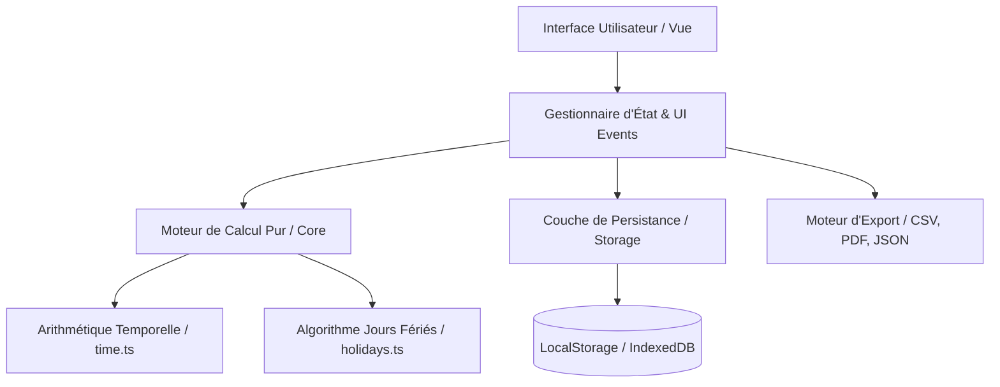

# Architecture & Conception Technique - Work Calculator

## 1. Vue d'ensemble

**Work Calculator** est une application moderne et réactive de calcul des heures de prestation, conçue pour remplacer avantageusement le fichier Excel historique tout en garantissant une compatibilité totale avec les formats de données existants.

Elle fonctionne de manière native et fluide sur **Windows, macOS et Linux** selon une architecture découpée en couches étanches.



---

## 2. Principes Fondamentaux de Conception

### 2.1. Fonctions Pures et Zéro Effet de Bord (`src/core/`)
* **Déterminisme absolu** : Aucun appel DOM, réseau ou état mutable dans le cœur métier.
* Toutes les conversions (`parseTimeToMinutes`, `minutesToTimeString`) et les calculs journaliers/mensuels sont des fonctions pures.
* **100% Testable** : Couverture unitaire totale possible sans mock ni émulateur.

### 2.2. Robustesse Temporelle
* Dans Excel, les heures négatives créent des erreurs d'affichage classiques (`######`).
* Dans Work Calculator, toutes les opérations mathématiques internes s'effectuent en **minutes entières signées** (`number`).
* L'affichage en format horaire (`±HH:MM:SS`) intervient uniquement au niveau de la couche de présentation.

### 2.3. Continuité d'un Mois sur l'Autre (Rollover)
* À chaque changement de mois, le solde cumulé du mois $M-1$ est automatiquement interrogé et reporté dans le champ **Solde du mois précédent** du mois $M$.
* L'utilisateur conserve la possibilité de surcharger manuellement ce report si un ajustement comptable est requis.

### 2.4. Mode Déconnecté & Résilience des Données (Offline-First)
* Aucune dépendance à un serveur central pour fonctionner.
* Sauvegarde automatique à la frappe (`blur` et `change`).
* Export complet en un clic au format JSON pour sauvegarder ou migrer d'une machine à une autre sans perte.

---

## 3. Structure des Répertoires

```
Work Calculator/
├── .github/
│   └── workflows/
│       ├── ci.yml                 # Validation TypeScript et linting automatisé
│       └── release.yml            # Build cross-platform automatique
├── docs/
│   ├── ARCHITECTURE.md            # Ce document
│   ├── SPECIFICATIONS.md          # Spécifications et formules de calcul
│   ├── USER_GUIDE.md              # Manuel d'utilisation
│   └── DEVELOPER_GUIDE.md         # Guide pour les développeurs
├── src/
│   ├── core/
│   │   ├── calculations.ts        # Moteur de calcul journalier et mensuel
│   │   ├── calculations.test.ts   # Tests unitaires Vitest
│   │   ├── holidays.ts            # Calculateur des jours fériés (Belgique, France, etc.)
│   │   └── time.ts                # Parseur et formateur d'heures
│   ├── export/
│   │   ├── backup.ts              # Sauvegarde / Restauration JSON
│   │   ├── excel.ts               # Export CSV / Excel conforme au format Didier
│   │   └── pdf.ts                 # Feuille de prestation prête à signer
│   ├── storage/
│   │   └── db.ts                  # Persistance locale et paramètres
│   └── types/
│       └── index.ts               # Types TypeScript stricts
├── index.html                     # Application autonome immédiatement exécutable
├── package.json                   # Dépendances et scripts de build
├── tsconfig.json                  # Configuration TypeScript stricte
└── vite.config.ts                 # Configuration du bundler Vite
```

---

## 4. Stratégie Multi-Plateforme (Windows, Mac, Linux)

L'application est conçue pour être délivrée de deux façons complémentaires :

1. **Standalone zéro-installation (`index.html`) :**
   * Peut être double-cliqué directement depuis l'explorateur de fichiers de Windows, le Finder de macOS ou le gestionnaire de fichiers de Linux.
   * Utilise les fonctionnalités modernes des navigateurs (Web Storage, Canvas, Print CSS, BOM UTF-8).
2. **Binaire Desktop Natif (Tauri / Electron) :**
   * Emballage via **Tauri** pour produire un installateur léger (`.exe` Windows, `.dmg` macOS, `.AppImage` Linux) consommant moins de 25 Mo de mémoire RAM.
